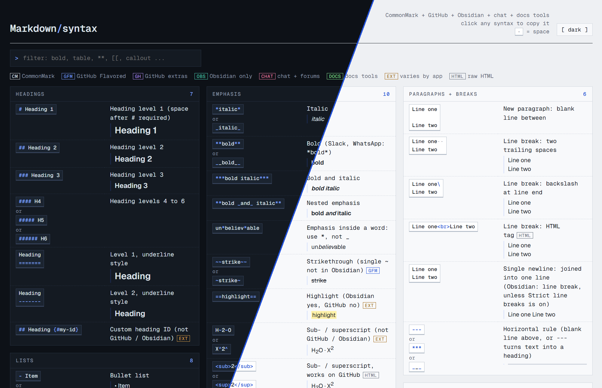

# Markdown Cheat Sheet

A searchable, single-page cheat sheet of [Markdown](https://commonmark.org) syntax: CommonMark, GitHub Flavored Markdown, Obsidian, chat apps (Slack, Discord, Teams, WhatsApp, Telegram, Reddit, Stack Overflow), documentation tools (MkDocs, Docusaurus, VitePress, GitBook, Hugo, GitLab, Azure DevOps) and the common extensions.

**Live:** https://klggr.de/portfolio/17-Markdown-Cheat-Sheet/markdown-syntax.html

## Features

- 140 entries grouped into 16 sections: headings, emphasis, paragraphs + breaks, lists, links, images, code, blockquotes, tables, escaping + entities, extended, Obsidian links + embeds, Obsidian callouts + more, chat + forums, docs tools + dev platforms and HTML in Markdown
- Every entry shows the syntax, what it does and, where it helps, the rendered result
- Markup characters are highlighted, so `**bold**` reads as markup around content
- Click any syntax to copy it to the clipboard
- Filter as you type, by name ("table", "callout"), by syntax ("**", "[[") or by app ("slack", "gitlab", "obsidian")
- Tags show where syntax works: *gfm* (GitHub Flavored Markdown), *gh* (GitHub extras), *obs* (Obsidian only), *chat* (chat apps + forums), *docs* (documentation tools + dev platforms), *ext* (varies by app), *html* (raw HTML). Untagged syntax works in every CommonMark renderer (*cm*)
- Click a tag in the legend to hide or show its entries, e.g. switch off *gh* when writing for Obsidian. Works together with the text filter
- Where GitHub and Obsidian differ (line breaks, highlight, alerts vs. callouts, Markdown inside HTML), the entry says so
- Dark and light mode (follows the system, with a manual toggle)
- Works on mobile
- One HTML file, no dependencies apart from the Geist and Geist Mono web fonts

## Usage

Open `markdown-syntax.html` in a browser. To add or change an entry, edit the `DATA` list in the script at the bottom of the file. A `·` in the syntax marks a space that matters (trailing spaces, indentation) and is copied as a real space.

## Sources

Based on the [CommonMark spec 0.31.2](https://spec.commonmark.org/0.31.2/), the [GitHub Flavored Markdown spec](https://github.github.com/gfm/), [GitHub Docs](https://docs.github.com/en/get-started/writing-on-github/getting-started-with-writing-and-formatting-on-github/basic-writing-and-formatting-syntax), the [Markdown Guide](https://www.markdownguide.org/extended-syntax/), [Obsidian Help](https://obsidian.md/help/obsidian-flavored-markdown) and the official docs of [Slack](https://docs.slack.dev/messaging/formatting-message-text), [Discord](https://support.discord.com/hc/en-us/articles/210298617), [Teams](https://support.microsoft.com/en-US/teams/chat/use-markdown-formatting-in-microsoft-teams), [Telegram](https://core.telegram.org/bots/api#markdownv2-style), [MkDocs Material](https://squidfunk.github.io/mkdocs-material/reference/admonitions/), [Docusaurus](https://docusaurus.io/docs/markdown-features/admonitions), [VitePress](https://vitepress.dev/guide/markdown), [GitBook](https://gitbook.com/docs/creating-content/blocks/hint), [Hugo](https://gohugo.io/content-management/shortcodes/), [GitLab](https://docs.gitlab.com/user/markdown/) and [Azure DevOps](https://learn.microsoft.com/en-us/azure/devops/project/wiki/markdown-guidance).

Spotted a wrong or missing entry? Open an issue or a pull request.

## License

[GNU General Public License v3.0](LICENSE)
